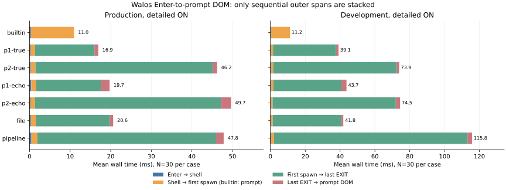

# ターミナル E2E 計測結果（2026-10-25）

Issue #20 の本番UIハーネスで、全7ケースを同一セッション内で逐次実行した。各ケースは初回1回・除外ウォームアップ3回・保持30回。詳細計測ON/OFFを別セッションで実行し、実行順を逆にした追試も保存した。**現行jscoの実UIでは、毎コマンド約1秒という現象は再現しなかった。**

全測定のソース: `bfb5f342ecc6930a4b36ab21a7368ad3a44c28d8`（dirty=false）。ツリー: `701d82c2a702692d62202840b6c57d8d0896f3c5`。レポート・データ追加はその後の文書変更。

環境: AMD EPYC 9V74 80-Core Processor、Linux 6.18.55 / x64、logical CPUs=3、available parallelism=2。Chromium 154.0.8037.57、Playwright 1.56.1、Node v24.19.0、wasi-sdk 27.0、jsco 0.2.0-preview.0。

headedは同じホストのXvfb 21.1.16（1280×720×24、`:99`）上で実行した。物理画面への表示完了や実機GPUの測定ではない。すべて一度に1つのベンチのみを実行し、ビルド・テストとは重ねなかった。

## 本番のEnter → 該当プロンプトDOM

単位ms、各セルは中央値 / p95、すべてN=30。OFFはIDと完了通知・最小UI計測を残し、詳細タイムラインとローダーメトリクスだけを無効にした基準。ON/OFF両方に相関処理のコストは含まれる。

| ケース   |    Headless OFF |     Headless ON |      Headed OFF |       Headed ON |
| -------- | --------------: | --------------: | --------------: | --------------: |
| builtin  |  8.737 / 10.170 | 12.187 / 14.580 |  9.215 / 11.365 | 12.333 / 15.785 |
| p1-true  | 15.815 / 20.230 | 16.797 / 19.360 | 16.840 / 19.780 | 16.935 / 19.915 |
| p2-true  | 45.638 / 52.765 | 45.785 / 50.995 | 46.390 / 53.470 | 45.677 / 51.315 |
| p1-echo  | 18.755 / 25.905 | 18.880 / 25.260 | 19.120 / 23.560 | 19.205 / 23.055 |
| p2-echo  | 48.598 / 61.110 | 48.632 / 56.590 | 48.527 / 55.615 | 48.342 / 55.315 |
| file     | 18.980 / 22.530 | 20.050 / 24.440 | 20.392 / 22.780 | 20.847 / 25.605 |
| pipeline | 46.345 / 54.705 | 47.363 / 52.425 | 52.100 / 55.580 | 49.733 / 60.240 |

出力・全子プロセスのEXIT/終了コード・次入力可能状態を毎回検証した。主測定420件、headed420件、逆順420件、開発420件の保持試行に失敗なし。初回・ウォームアップ・補助条件も除外せずraw JSONに保存している。p99は各条件N=30では推定しない。min/max、平均、標準偏差、全区間の中央値/p95は隣接する集計とraw JSONに含む。

## 区間による説明

次の表は本番headless ON、中央値 / p95（ms）。区間の中央値同士を足してE2Eを再構成しない。

| 区間                           |         P1 true |         P2 true |        Pipeline |
| ------------------------------ | --------------: | --------------: | --------------: |
| inputToShellMs                 |   0.205 / 0.440 |   0.213 / 0.995 |   0.213 / 1.325 |
| shellToFirstSpawnMs            |   0.992 / 1.820 |   0.958 / 2.050 |   1.235 / 2.795 |
| firstSpawnToLastExitMs         | 14.623 / 17.040 | 43.345 / 49.620 | 43.912 / 47.825 |
| lastExitToPromptDomMs          |   0.818 / 2.325 |   0.800 / 2.775 |   1.788 / 3.450 |
| child0.workerStartupMs         | 12.642 / 14.770 | 39.110 / 45.365 | 12.073 / 13.995 |
| child0.workerCreateToModuleMs  |  8.650 / 10.595 |  8.998 / 10.245 |  8.517 / 10.550 |
| child0.readMs                  |   1.068 / 1.660 |   1.130 / 2.280 |   0.935 / 1.160 |
| child0.adapterMs               |   0.880 / 1.710 |   0.823 / 1.030 |   0.825 / 0.940 |
| child0.compileMs               |   0.420 / 0.635 |               — |   0.415 / 0.615 |
| child0.instantiateMs           |   0.472 / 0.595 |               — |   0.475 / 0.685 |
| child0.loadMs                  |               — | 27.110 / 32.090 |               — |
| child0.component.engineLoadMs  |               — |   7.740 / 9.290 |               — |
| child0.component.prepareMs     |               — | 13.930 / 17.630 |               — |
| child0.component.instantiateMs |               — |   4.900 / 5.655 |               — |
| child0.runMs                   |   1.060 / 1.450 |   3.345 / 3.805 |   8.712 / 9.890 |

図だけは平均値で直列区間を積み上げた。子プロセス同士やloadMsの内部区間は足していない。builtinの第2区間はshell受信→prompt DOM全体である。

P1 trueはWorker単体の起動境界がE2Eの大半を占める。このうちWorker生成→プロセスモジュール初期化は約8.65ms、バイナリ読込・adapter・compile/instantiateは各約0.4〜1.1ms。P2 trueは同じWorker経路に加えloadMs約27.11ms（内部のjsco engine load約7.74ms、prepare約13.93ms、instantiate約4.90ms）がある。これらは内包区間なので重複加算しない。

同じサンプル内で差を計算してから集計すると、起動だけでは説明しない残り時間は次の通りになる。単位ms、中央値 / p95。

| 指標                    |         P1 true |         P2 true |
| ----------------------- | --------------: | --------------: |
| durationMs              | 14.363 / 16.240 | 43.165 / 49.360 |
| e2eMinusWorkerStartupMs |   4.110 / 5.415 |   6.655 / 8.475 |
| e2eMinusDurationMs      |   2.750 / 3.750 |   2.617 / 4.805 |

Pipelineは3つすべてのpid/argv・spawn/READY/EXIT・パイプRPCとstream ID/EOF/closeを保持した。各子の実行・I/Oは重なる。単純に各WorkerのdurationMsを合計していない。builtinは子Workerがなく、待ち時間は主にshellのプロンプト書込→UI配送/DOMの領域にある。この領域にはブラウザのタスク配送や自動操作の影響も入り、CPU消費や単一の内部関数の遅さと断定できない。

## 計測オーバーヘッド

| ケース   | ON−OFF 中央値差（通常順） | 逆順追試 |
| -------- | ------------------------: | -------: |
| builtin  |                  3.450 ms | 4.005 ms |
| p1-true  |                  0.982 ms | 0.842 ms |
| p2-true  |                  0.147 ms | 0.155 ms |
| p1-echo  |                  0.125 ms | 1.625 ms |
| p2-echo  |                  0.035 ms | 0.843 ms |
| file     |                  1.070 ms | 2.670 ms |
| pipeline |                  1.018 ms | 1.057 ms |

高速なbuiltinでは3.45〜4.01ms、相対では約40〜48%の増分があり、無視できない。P1 trueは約0.84〜0.98ms、P2 trueは約0.15msだった。計測コストを差し引かず、ユーザーの遅延基準にはOFF、原因切り分けにはONを併記する。raw計測はタイミングに関係なくすべて保持し、独立リサンプリング10,000回・固定seedによる中央値比の95%区間を[overhead.json](2026-10-25-terminal-e2e/overhead.json)に保存した。逐次セッション間の変動を完全に除去するものではない。

## 開発ビルド・初回・キャッシュ条件

| ケース   | Production ON median / p95 | Development ON median / p95 |
| -------- | -------------------------: | --------------------------: |
| builtin  |            12.187 / 14.580 |             12.345 / 14.935 |
| p1-true  |            16.797 / 19.360 |             38.268 / 46.455 |
| p2-true  |            45.785 / 50.995 |             73.610 / 91.945 |
| p1-echo  |            18.880 / 25.260 |             42.228 / 53.495 |
| p2-echo  |            48.632 / 56.590 |             74.517 / 79.850 |
| file     |            20.050 / 24.440 |             41.922 / 47.370 |
| pipeline |            47.363 / 52.425 |           113.478 / 138.455 |

開発サーバーはP1 true約38ms、P2 true約74ms、pipeline約113msで、本番より遅いが1秒には達しない。開発UIで実際に遅延が大きいのはWorker生成〜READYの領域であり、P1も同様に増える。モジュールの配信/初期化とスケジューリングを含み、P2変換だけの影響ではない。

reloadとfresh browser contextは各N=3の補助測定にとどめ、主測定と混ぜない。freshは各保持サイクルで新しいcontextを作り、warmupなし・コマンド順を回転。reloadは同じcontext/OPFSを保持して再読込した。初回・再読込後初回・bootstrap区間は別ラベル/セッションメタデータで保存し、定常コマンドの統計に混ぜていない。元の約1秒報告のブラウザ/ハードウェア/ビルド条件はIssue本文にないため、今回の条件差だけでその報告の原因を特定したとは主張しない。

## 既存のstartupMsとの比較

すべて同じソース・ホスト・Chromiumで30回。旧ランナーのP2既定値はJco、実UIの既定値はjscoなので区別する。旧fixtureはshell/Core/UIを通らず、新しいブラウザごとにcold→warmを実行する。実UIの主測定は起動済みセッションで反復するため、キャッシュ状態も完全一致ではない。

| 経路                                                     | 指標               |     median / p95 ms |
| -------------------------------------------------------- | ------------------ | ------------------: |
| P1 standalone fixture (warm)                             | startupMs          |     20.430 / 46.175 |
| P1 actual true                                           | workerStartupMs    |     12.642 / 14.770 |
| P1 actual true OFF                                       | inputToPromptDomMs |     15.815 / 20.230 |
| P2 jsco standalone fixture (warm assets, cache disabled) | startupMs          |     46.560 / 73.075 |
| P2 actual jsco true                                      | workerStartupMs    |     39.110 / 45.365 |
| P2 actual jsco true OFF                                  | inputToPromptDomMs |     45.638 / 52.765 |
| P2 Jco standalone fixture (cold conversion miss)         | startupMs          | 1072.818 / 1181.515 |
| P2 Jco standalone fixture (OPFS hit)                     | startupMs          |     35.490 / 52.920 |

JcoのP2コールド変換は約1.07秒を実測したが、これはP1の遅延の説明にはならない。また、今回の実UI既定jscoにはその変換経路がない。実UIのE2Eと起動境界の差は同一サンプルのShell/RPC/run/wait/TTY/DOMの区間から説明し、異なるfixtureの中央値を引き算して原因を断定しない。

| バイナリ       | bytes | SHA-256                                                          |
| -------------- | ----: | ---------------------------------------------------------------- |
| P1 fixture     | 27569 | 526bf7c138d2f7f4e4b50cb740009d6875e731c1ba86b6aa87df2a47f54dbea0 |
| P1 actual true | 31863 | 88846a3ff5f5f25da7aa1a4956ab308a522e091f516faa272fd029cc3f9129f9 |
| P2 fixture     | 64123 | f616d0be00c46e6d467d65e0fb40717c0f138a2bcae9e90db6b321151ac98ab8 |
| P2 actual true | 70284 | 7be440403d2e37950ae9d1a663087d9b759c7bfb16a47972ddf37e8a28f2994d |

## Raw data と再現

JSONは元のバイト列をgzip圧縮して保存した。隣接manifestに圧縮前後のサイズとSHA-256がある。展開例: `gzip -dc e2e-production-headless.json.gz > e2e-production-headless.json`。主測定の全476サンプル（保持420件、初回/ウォームアップ56件）と失敗欄・環境・バイナリ/asset SHA・相関ID・時刻/clock checksを取得できる。

- [e2e-production-headless: raw JSON.gz](2026-10-25-terminal-e2e/e2e-production-headless.json.gz) / [全区間の集計](2026-10-25-terminal-e2e/e2e-production-headless.md)
- [e2e-production-headed: raw JSON.gz](2026-10-25-terminal-e2e/e2e-production-headed.json.gz) / [全区間の集計](2026-10-25-terminal-e2e/e2e-production-headed.md)
- [e2e-development: raw JSON.gz](2026-10-25-terminal-e2e/e2e-development.json.gz) / [全区間の集計](2026-10-25-terminal-e2e/e2e-development.md)
- [e2e-production-reversed: raw JSON.gz](2026-10-25-terminal-e2e/e2e-production-reversed.json.gz) / [全区間の集計](2026-10-25-terminal-e2e/e2e-production-reversed.md)
- [e2e-cache-conditions: raw JSON.gz](2026-10-25-terminal-e2e/e2e-cache-conditions.json.gz) / [全区間の集計](2026-10-25-terminal-e2e/e2e-cache-conditions.md)
- [e2e-worker-baseline: raw JSON.gz](2026-10-25-terminal-e2e/e2e-worker-baseline.json.gz) / [全区間の集計](2026-10-25-terminal-e2e/e2e-worker-baseline.md)
- [e2e-worker-jsco: raw JSON.gz](2026-10-25-terminal-e2e/e2e-worker-jsco.json.gz) / [全区間の集計](2026-10-25-terminal-e2e/e2e-worker-jsco.md)
- [e2e-traced: raw JSON.gz](2026-10-25-terminal-e2e/e2e-traced.json.gz) / [全区間の集計](2026-10-25-terminal-e2e/e2e-traced.md)
- [別取りのChrome Performance trace](2026-10-25-terminal-e2e/e2e-trace.json.gz)（通常測定と混ぜない）
- [manifestとハッシュ](2026-10-25-terminal-e2e/manifest.json)

時計はperformance.timeOrigin + performance.now()で整合性をチェックした。通常の主測定だけで3,672の通信順序境界を検証し、許容範囲を超える負の時間・欠落境界はなかった。プロンプト完了は文字列検索ではなくコマンドIDと同じstdoutチャネルの完了通知で判定する。DOMはappend直後、同期スクロールより前の時刻。参考のrAFは描画完了を保証しない。

正式再現コマンド・各キャッシュ条件・trace取得手順は[仕様](../benchmarks-e2e.md)を参照。主測定は `CHROMIUM_PATH=/usr/bin/chromium npm run benchmark:e2e -- --trials 30 --warmups 3`。headedはXvfb起動後に `DISPLAY=:99 ... node benchmarks/e2e.mjs --trials 30 --headed`。単体は `npm run benchmark -- --trials 30` と `npm run benchmark -- --engines jsco --trials 30`。

検証: 開発UI回帰130 passed / 1 skipped、本番UI回帰14 passed / 1 skipped、統計テスト3件・E2E境界テスト4件、既存ベンチ30回、jscoベンチ30回が成功。スキップはjscoのcacheless動作に対応する既存条件付きテスト。修正後の本番UI回帰も再実行した。CIには全7ケース各1件の正確性スモークとartifact保存を追加し、絶対時間の閾値は設けない。

改善候補はP2のprepare/loadの反復コストと、高速builtinで見える詳細計測の観測コスト。今回の計測PRではWorkerプールや実行エンジンの変更を行わない。

実測に基づく後続Issue:

- [#21: jsco prepare / instantiate の反復コスト](https://github.com/0x5341/walos/issues/21)
- [#22: 高速builtinに対する詳細診断の観測コスト](https://github.com/0x5341/walos/issues/22)
